# 模块化迁移进度

本批按模块化迁移方案拆分现有实现，保留旧入口和本地数据格式。十二个模块均有显式公开入口与依赖清单，模块内部没有旧 store、文件系统或 Tauri 依赖；应用组合层注入存储和执行器适配。

| 模块 | 已迁出实际代码 | 后续迁移 |
| --- | --- | --- |
| star-map | 场景、投影、Canvas 与交互（上一批） | Wiki/记忆到场景的查询适配 |
| memory | 数据模型、校验、保存/删除用例、仓储端口、受控记忆页 | 权限、共享记忆、并发服务 |
| domains | 标签和资源多选关联、领域用例、仓储端口、受控编辑器 | 后端资源授权与分类查询 |
| tasks | 执行器注册、外部取消、作用域隔离、受控任务页 | 持久化调度与统一历史 |
| quality | 结构检查算法、配置规范化、检查类型、Wiki 检查执行器 | 语义检查 I/O、纠错写入适配 |
| research | 研究模型、正文与引用校验、编排执行器、受控研究列表 | 搜索配置/证据筛选 I/O、持久调度 |
| wiki | 页面仓储/修订接口、合并/链接规则、编辑预览/纠错适配、受控历史 UI | 生成提交上下文、元数据/完整版本统一、编辑冲突 UI、知识回流 |
| ingestion | 文本清洗、编译执行器、独立队列服务、恢复/调度/快照端口、有序提交 | 解析/编译 I/O、Obsidian 回执、强持久化服务 |
| projects | 项目/身份/注册表/偏好模型、仓储和本地适配 | 成员/授权、共享服务 |
| documents | 来源规则/目录/修订查询、监听/导入/移动组合、文件历史端口 | API/MCP 全入口、完整来源生命周期与强事务 |
| retrieval | Markdown 分块算法 | 索引、搜索、LLM 检索 |
| cli | Claude/Codex 协议与错误解析 | 进程/会话适配、授权身份 |

## 应用组合与兼容

- `src/app/workspace/snapshot.ts` 保存 v1 文件兼容外壳；记忆与领域各自定义模型，不依赖此聚合类型。
- `src/app/workspace/json-repository.ts` 保留 `.llm-wiki/workspace.json` 路径、项目锁和原子写入。损坏文件不覆盖，未知顶层字段保留。此批无需数据迁移。
- `src/app/workspace/services.ts` 为模块注入仓储；领域删除作为跨模块工作流，在一次持久化操作内清理资源和记忆引用。
- `workspace-store.ts` 作为界面投影，只提交语义命令；项目切换时拒绝旧结果，即使切走后又返回同一路径。旧 `update` 暂供兼容调用者使用。
- 记忆/领域界面仅接收数据、操作回调和插槽；原组件作为应用容器负责绑定项目/store。
- `src/app/tasks/maintenance.ts` 注册 Wiki 检查执行器并投影到现有活动记录。任务执行不绑定检查视图生命周期。
- 原 `src/lib/` 路径保留公开重导出，原测试继续验证这些兼容入口。CLI transport 保留平台逻辑，仅协议解析迁入模块。

```mermaid
flowchart TD
  Containers[页面容器 / Store 投影] --> App[应用组合层 app]
  Containers --> UI[记忆 / 领域 / 星图 UI]
  App --> Memory[Memory 服务与仓储端口]
  App --> Domains[Domains 服务与仓储端口]
  App --> Tasks[Tasks 执行器运行时]
  Tasks --> Executor[注入的 Quality 检查执行器]
  App --> Adapter[本地 JSON / 文件 / 模型适配器]
  Adapter --> Snapshot[现有 workspace.json]
  Legacy[旧入口兼容层] --> Pure[Wiki / 入库 / 检索 / CLI 纯规则]
```

## 验证与下一批

本批验证结果：

- 模块边界检查通过（十二个模块），类型检查通过。
- 完整模拟回归：148 个测试文件、2098 项测试通过。随后新增的 Store 并发/切换测试：3 项通过。
- 正式前端与预览构建通过；保留既有分包警告。
- Chromium 在线与加载后断网预览均通过：记忆创建保存、搜索、任务切换、Wiki 模式切换和星图交互，无页面运行异常。
- 模拟验证不代表原生 Tauri 或真实模型已验收；当前环境没有 Rust 工具链。

导入队列现已通过执行器运行（B02），队列状态机/恢复/持久化端口已抽离（B03）；研究执行器与受控任务 UI 已完成（B04/B05），下一批优先项目/文档仓储（B06/B07），再逐步迁移 Wiki 仓储与 Obsidian 回执适配。identity/AccessContext 及共享记忆后端需要新增实现，不作为本批代码搬迁已完成项。移除兼容入口之前，应先迁移全部调用者与对应测试。

最新任务与验证以根目录 [TASKS](../../TASKS.md)、[WORKLOG](../../WORKLOG.md)、[HANDOFF](../../HANDOFF.md) 为准。上述首批测试数字是历史记录。

## B03 队列服务迁移

- `modules/ingestion/application/queue.ts` 拥有每实例独立的完整队列状态；平台依赖经 queue-ports 注入。
- `domain/queue-task.ts` 与 `queue-snapshot.ts` 保存旧任务模型和数组快照兼容；commit-coordinator 保持有序写入。
- `app/ingestion/queue.ts` 为现有桌面调用者创建单例，`queue-repository.ts` 保持旧文件路径；原 lib 仅作兼容重导出。
- 新增恢复 epoch 检查，避免旧异步读取污染后续项目或同项目新恢复；计时器支持注入的零值句柄。
- 强持久化、损坏队列恢复与跨进程任务调度没有在本次实现；活动写入 best-effort 语义保持原样。

当前 B08c2 已完成并按用户要求暂停；B08c3 尚未开始。最新精确状态见根目录 TASKS/WORKLOG/HANDOFF。
