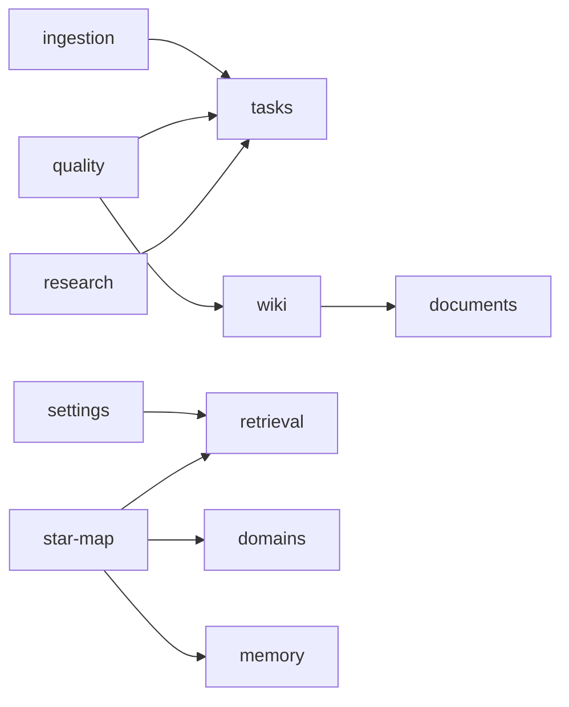

# B16 模块边界审计

本次 B10–B16 继续对现有本地实现做模块化迁移。审计覆盖整个 `src/` 的静态生产导入（包含类型导入、重导出和字面量动态导入）、模块层级/依赖及旧入口引用；不把旧文件重导出或界面预览计为生产后端能力。

当前：415 个生产源文件，15 个模块，模块内 149 个生产文件，33 个仍有调用/测试的 lib 兼容入口。边界与审计错误为 0。机器可读结果：[module-audit-v1.json](module-audit-v1.json)。

| 模块 | 生产文件 | 模块内测试文件 | 声明依赖 |
| --- | ---: | ---: | --- |
| agent | 11 | 2 | — |
| cli | 11 | 1 | — |
| documents | 8 | 0 | — |
| domains | 6 | 1 | — |
| ingestion | 10 | 3 | tasks |
| memory | 6 | 1 | — |
| obsidian | 5 | 1 | — |
| projects | 5 | 0 | — |
| quality | 19 | 2 | tasks, wiki |
| research | 8 | 1 | tasks |
| retrieval | 14 | 2 | — |
| settings | 15 | 1 | retrieval |
| star-map | 8 | 3 | domains, memory, retrieval |
| tasks | 5 | 2 | — |
| wiki | 18 | 3 | documents |

测试文件数仅是模块目录中的文件，不含旧兼容入口测试、应用适配测试或脚本测试。最终完整模拟回归为 178 文件 / 2231 项。

## 依赖方向



所有模块的 `allowedLegacyImports` 均为空；领域层只能依赖本模块领域文件，跨模块用例通过声明的应用依赖和公开入口组合。模块不得依赖旧 Store、Tauri 或文件系统；应用/原生适配在 `src/app/`。

## 可重复检查

```bash
npm run check:modules
npm run audit:modules
npm run audit:modules:check
npm run typecheck
npm run test:mocks
npm run build
npm run build:preview
```

`check:modules` 原本就扫描整个生产源码树的私有入口引用，本轮没有再实现另一套相同检查。新增领域层直接调用浏览器 I/O 的检测，防止通过 `fetch`/`window` 等全局对象绕过导入约束。审计报告另外验证模块说明、无 legacy 例外和兼容入口引用；更新源文件/公开契约后需重新生成报告。CI 增加报告一致性检查。

领域全局检测是静态防回归规则，不是完整 JavaScript 沙箱证明；模块外的运行时计算导入、Rust 与第三方内部实现不在此 TypeScript 审计范围。

## 兼容入口取舍

删除零生产/测试引用的 `lib/memory-sea-scene.ts`。以下四项没有生产引用，但仍被契约测试使用，因此保留：

- `lib/ingest-commit-coordinator.ts`
- `lib/lint-fixes.ts`
- `lib/review-utils.ts`
- `lib/text-chunker.ts`

其余兼容入口仍有生产调用，详细计数在 JSON。历史分析中提到已删除入口的文字保留为迁移历史，以本报告和当前树为准。

## 验证与边界

模块边界/审计脚本相关 2 文件 / 10 项通过；正式和单文件预览构建通过。Chromium 七组沙箱验证覆盖正常编辑/冲突保留草稿、历史恢复与项目 ABA、对话/审阅发布、本地搜索与迟到结果、任务页、Wiki/64 条模拟记忆场景切换、同页批量纠错一次提交、设置的模拟能力提示；页面异常为 0。

Rust Agent 路由/工具/会话和原生文件/历史/向量存储继续使用上游既有模块，没有在前端复制引擎。本环境无 cargo，真实模型、真实 Vault、真实本机 CLI、安装包和远端 CI 未验收。

B07c 仍依赖 C02/I02 的新增共享 API/MCP 链路；B07 总项不勾选。生产账号/授权、共享记忆、Web 后端、强持久任务恢复和最终真实星图分别留在后续 C/F/H/G/J 系列。解析/模型传输等部分旧 lib 仍作为应用适配或兼容编排存在，不把这次审计描述为消灭全部旧代码。
