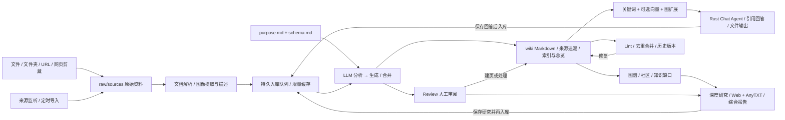
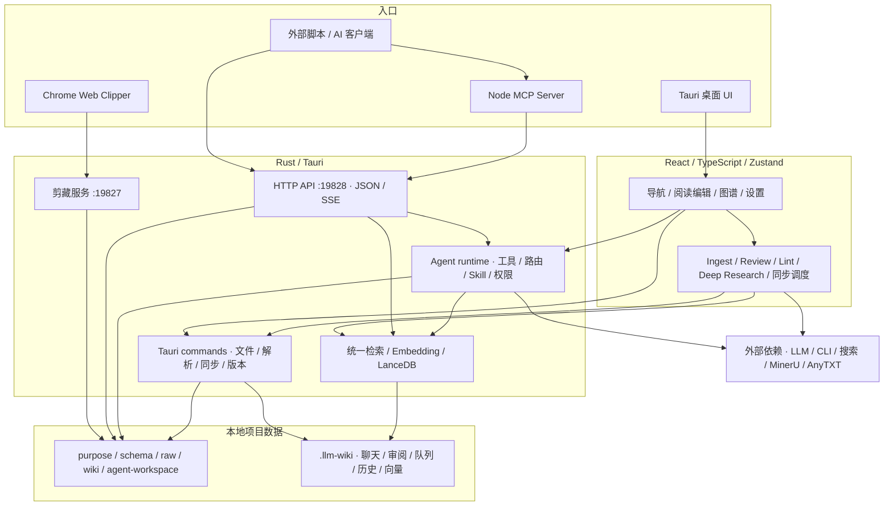

# LLM Wiki 原生功能拆解与改造基线

分析日期：2026-10-31（Asia/Shanghai） 
仓库：https://github.com/nashsu/llm_wiki 
基线：main / v0.6.13 / `e08cfce65aad8b76b13546a081c1a8d4422b70c3`（提交日期 2026-10-21） 
范围：桌面前端、Rust 后端、Chrome 扩展、内置 MCP、配置与持久化。按产品能力而非每一个按钮拆成 **12 个功能域、93 个功能项**。

## 1. 结论与验证口径

LLM Wiki 的核心是“把资料持续编译为可追溯的 Markdown Wiki”，包含检索问答、知识图谱、审阅维护和研究回流。它已经超出传统文档 RAG，但整体仍围绕本机项目文件夹和桌面进程组织。

本报告依据 README、界面入口、调用方和实现代码交叉核对。清单中的“源码确认”表示存在对应入口/实现或明确的底层能力，**不等于已运行验收或质量保证**。本次未安装依赖、启动 Tauri、调用真实模型或对每种文件格式做样本测试；性能、模型效果、平台差异与部署可用性均待验证。无账号/密钥也不影响本次静态分析。

工具适配：使用已连接 GitHub 插件确认仓库，参考 plugin-management 与 cloud-environment-runtime skill，再克隆源码进行全量检索。Mermaid 保存结构源，Graphviz 生成无需网络的 SVG 快照。上游推荐的 llm-wiki skill 用于查询运行中的知识库，不负责分析源码，因此未为此安装它。未使用外部绘图 SaaS，也未修改业务实现或推送远端。

## 2. 功能框图

可编辑版本：[01-feature-map.mmd](01-feature-map.mmd)；静态图：[01-feature-map.svg](01-feature-map.svg)。

```mermaid
flowchart TB
  ROOT["LLM Wiki v0.6.13 · 当前功能"]
  ROOT --> P["项目与知识结构"]
  P --> P0["新建项目与场景模板<br/>打开、切换与最近项目<br/>知识目标与结构规则"]
  P --> P3["Markdown 知识模型<br/>知识树与文件树<br/>项目迁移与索引重建"]
  ROOT --> S["资料采集与同步"]
  S --> S0["多文件导入<br/>递归文件夹导入<br/>批量 URL 导入"]
  S --> S3["Chrome 网页剪藏<br/>剪藏接收服务<br/>项目来源目录监听"]
  S --> S6["定时外部目录导入<br/>同步规则与并发设置<br/>来源管理与级联删除"]
  ROOT --> D["解析与多模态"]
  D --> D0["文本与结构化文本<br/>Office 文档转 Markdown<br/>PDF 文字和图片提取"]
  D --> D3["MinerU 可选解析<br/>电子书提取<br/>图片描述与图文入库"]
  D --> D6["解析预处理和缓存<br/>音视频与未知二进制边界"]
  ROOT --> I["知识编译与任务队列"]
  I --> I0["两阶段入库<br/>增量跳过<br/>长资料分块与上下文控制"]
  I --> I3["生成与更新知识资产<br/>已有页面内容合并<br/>生成审阅项"]
  I --> I6["持久队列与恢复<br/>并发执行与提交协调<br/>任务进度与限额处理"]
  I --> I9["完成后的衍生维护"]
  ROOT --> R["搜索与证据检索"]
  R --> R0["关键词搜索<br/>可选向量语义检索<br/>混合排序与图扩展"]
  R --> R3["搜索结果与图片证据<br/>原文证据模式<br/>外部本机全文检索"]
  ROOT --> C["聊天与 Agent"]
  C --> C0["多会话管理<br/>四种 Agent 模式<br/>三种检索模式"]
  C --> C3["Rust 工具调用运行时<br/>流式过程与取消<br/>图像与上下文输入"]
  C --> C6["引用与证据预览<br/>对话写入 Wiki<br/>Agent 文件生成与变更展示"]
  C --> C9["Wiki 写入与 Shell 执行<br/>结构化用户交互"]
  ROOT --> E["阅读、编辑与版本"]
  E --> E0["阅读与富文本编辑<br/>数学与图表渲染<br/>文档与媒体预览"]
  E --> E3["元数据与链接导航<br/>选中文本 AI 问答<br/>选区 AI 修改与差异确认"]
  E --> E6["文件版本与恢复<br/>Wiki 页面删除"]
  ROOT --> G["知识图谱与洞察"]
  G --> G0["图谱构建与交互<br/>筛选与可见性控制<br/>四信号关联评分"]
  G --> G3["社区发现<br/>意外关联与知识缺口<br/>洞察触发研究"]
  ROOT --> Q["审阅与知识质量"]
  Q --> Q0["异步审阅队列<br/>审阅动作与批处理<br/>结构检查"]
  Q --> Q3["语义检查<br/>修复与批量处理<br/>实体去重检测"]
  Q --> Q6["去重合并队列<br/>审阅自动复核"]
  ROOT --> W["深度研究"]
  W --> W0["多入口选题<br/>网页与本地联合采证<br/>搜索服务适配"]
  W --> W3["报告综合与引用校验<br/>研究落盘与再入库<br/>研究任务面板"]
  ROOT --> X["Skill 与外部接口"]
  X --> X0["本地 Skill 扫描<br/>Skill 启停与会话选择<br/>JSON HTTP API"]
  X --> X3["Agent API 与 SSE<br/>API 访问配置<br/>MCP 适配服务"]
  X --> X6["外部 Agent skill 文档"]
  ROOT --> A["模型、设置与桌面运行"]
  A --> A0["多供应商与 CLI<br/>任务和项目模型路由<br/>推理与上下文配置"]
  A --> A3["独立处理服务设置<br/>网络代理<br/>语言与外观"]
  A --> A6["桌面生命周期<br/>版本与分发"]
```

## 3. 知识生命周期

关键区分：导入成功、解析成功、入库成功和检索索引就绪是不同阶段。Review 是异步判断队列，不是发布前的强制审批门。保存聊天/研究会重新进入入库链路，而不只是留下一条聊天记录。

## 4. 当前技术架构与模块关系

- **表现与业务编排**：React 19 + TypeScript + Zustand；编辑器 Milkdown，图谱 sigma/graphology。Ingest、Review、Lint、Deep Research、定时扫描等仍有重要前端业务逻辑。
- **本机后端**：Tauri v2 + Rust 提供文件、解析、监听、历史、检索、向量和 Agent。桌面聊天及 API/MCP 的聊天复用 Rust Agent；不应推断所有后台任务已成为独立服务。
- **检索**：当前 `search_project` 在 Rust 中执行关键词检索、可选向量、RRF 排序和图邻居扩展。图谱四信号评分是另一套关联能力，不能简单认为所有搜索都运行该公式。
- **模型与服务**：HTTP 模型或本地 CLI、独立 Embedding/视觉配置、网页搜索、MinerU、AnyTXT。可选本地服务也需要实际安装配置；默认打包不等于完整离线可用。
- **两个 HTTP 服务**：19827 为剪藏通信；19828 为 JSON/SSE API。后者支持可选 LAN 配置，API Token 不是多用户身份与权限体系。

## 5. 功能清单与源码定位

ID 将作为后续需求映射键；“保留/增强/重做/移除/新增”和优先级暂不填写，避免替团队预设目标。也提供 CSV/JSON，便于导入需求工具。每项所附源码链接固定到本次提交，后续上游更新不会改变证据基线。

### P · 项目与知识结构

| ID | 功能 | 当前行为与边界 | 实现依据 |
|---|---|---|---|
| P01 | 新建项目与场景模板 | 科研、阅读、个人成长、商业、通用模板，初始化 purpose/schema 和目录 | [src/lib/templates.ts](https://github.com/nashsu/llm_wiki/blob/e08cfce65aad8b76b13546a081c1a8d4422b70c3/src/lib/templates.ts) |
| P02 | 打开、切换与最近项目 | 恢复上次项目；项目 UUID 随目录迁移保持稳定 | [src/App.tsx](https://github.com/nashsu/llm_wiki/blob/e08cfce65aad8b76b13546a081c1a8d4422b70c3/src/App.tsx) |
| P03 | 知识目标与结构规则 | purpose.md 描述目标；schema.md 定义类型、目录、命名和引用规则 | [src/lib/wiki-schema.ts](https://github.com/nashsu/llm_wiki/blob/e08cfce65aad8b76b13546a081c1a8d4422b70c3/src/lib/wiki-schema.ts) |
| P04 | Markdown 知识模型 | 实体、概念、来源摘要、问答、综合、对比、总览及模板扩展类型 | [src/lib/wiki-page-types.ts](https://github.com/nashsu/llm_wiki/blob/e08cfce65aad8b76b13546a081c1a8d4422b70c3/src/lib/wiki-page-types.ts) |
| P05 | 知识树与文件树 | 按知识类型或文件目录浏览，搜索、折叠、选择文件 | [src/components/layout/knowledge-tree.tsx](https://github.com/nashsu/llm_wiki/blob/e08cfce65aad8b76b13546a081c1a8d4422b70c3/src/components/layout/knowledge-tree.tsx) |
| P06 | 项目迁移与索引重建 | ZIP 导入导出完整项目；从现有页面重建 index.md | [src/components/settings/sections/maintenance-section.tsx](https://github.com/nashsu/llm_wiki/blob/e08cfce65aad8b76b13546a081c1a8d4422b70c3/src/components/settings/sections/maintenance-section.tsx) |

### S · 资料采集与同步

| ID | 功能 | 当前行为与边界 | 实现依据 |
|---|---|---|---|
| S01 | 多文件导入 | 复制到 raw/sources，预解析，再进入入库队列 | [src/components/sources/sources-view.tsx](https://github.com/nashsu/llm_wiki/blob/e08cfce65aad8b76b13546a081c1a8d4422b70c3/src/components/sources/sources-view.tsx) |
| S02 | 递归文件夹导入 | 保留目录结构，目录作为分类上下文，处理目标文件重名 | [src/lib/source-lifecycle.ts](https://github.com/nashsu/llm_wiki/blob/e08cfce65aad8b76b13546a081c1a8d4422b70c3/src/lib/source-lifecycle.ts) |
| S03 | 批量 URL 导入 | 抓取 URL 内容并保存资料；限制重定向和体积 | [src/lib/url-source-import.ts](https://github.com/nashsu/llm_wiki/blob/e08cfce65aad8b76b13546a081c1a8d4422b70c3/src/lib/url-source-import.ts) |
| S04 | Chrome 网页剪藏 | Readability 提取、Turndown 转 Markdown、选择目标项目、快捷键 | [extension/popup.js](https://github.com/nashsu/llm_wiki/blob/e08cfce65aad8b76b13546a081c1a8d4422b70c3/extension/popup.js) |
| S05 | 剪藏接收服务 | 19827 端口接收剪藏；前端 watcher 发现新资料并入库 | [src-tauri/src/clip_server.rs](https://github.com/nashsu/llm_wiki/blob/e08cfce65aad8b76b13546a081c1a8d4422b70c3/src-tauri/src/clip_server.rs) |
| S06 | 项目来源目录监听 | 感知 raw/sources 的新增、修改、重命名、删除；同步生命周期 | [src-tauri/src/commands/file_sync.rs](https://github.com/nashsu/llm_wiki/blob/e08cfce65aad8b76b13546a081c1a8d4422b70c3/src-tauri/src/commands/file_sync.rs) |
| S07 | 定时外部目录导入 | 每项目一个监控目录；周期扫描与哈希/mtime 缓存；涉及最近项目 | [src/lib/scheduled-import.ts](https://github.com/nashsu/llm_wiki/blob/e08cfce65aad8b76b13546a081c1a8d4422b70c3/src/lib/scheduled-import.ts) |
| S08 | 同步规则与并发设置 | 扩展名、目录、glob、大小过滤；解析/入库并发；可监控多个最近项目 | [src/components/settings/sections/source-watch-section.tsx](https://github.com/nashsu/llm_wiki/blob/e08cfce65aad8b76b13546a081c1a8d4422b70c3/src/components/settings/sections/source-watch-section.tsx) |
| S09 | 来源管理与级联删除 | 来源搜索、刷新、手动入库、外部打开、删文件/目录；清引用并保留共享页面 | [src/lib/source-lifecycle.ts](https://github.com/nashsu/llm_wiki/blob/e08cfce65aad8b76b13546a081c1a8d4422b70c3/src/lib/source-lifecycle.ts) |

### D · 解析与多模态

| ID | 功能 | 当前行为与边界 | 实现依据 |
|---|---|---|---|
| D01 | 文本与结构化文本 | Markdown、普通文本、Org 等；文本与代码分类预览 | [src-tauri/src/commands/fs.rs](https://github.com/nashsu/llm_wiki/blob/e08cfce65aad8b76b13546a081c1a8d4422b70c3/src-tauri/src/commands/fs.rs) |
| D02 | Office 文档转 Markdown | AnyDoc 优先；部分格式兼容解析；Word/演示/表格/OpenDocument/RTF | [src-tauri/src/commands/fs.rs](https://github.com/nashsu/llm_wiki/blob/e08cfce65aad8b76b13546a081c1a8d4422b70c3/src-tauri/src/commands/fs.rs) |
| D03 | PDF 文字和图片提取 | 当前内建路径含 PDFium；缓存、图片提取与项目媒体存储 | [src-tauri/src/commands/extract_images.rs](https://github.com/nashsu/llm_wiki/blob/e08cfce65aad8b76b13546a081c1a8d4422b70c3/src-tauri/src/commands/extract_images.rs) |
| D04 | MinerU 可选解析 | Cloud、Local API、Local Pipeline；处理复杂版面/OCR，存在回退路径 | [src/lib/mineru.ts](https://github.com/nashsu/llm_wiki/blob/e08cfce65aad8b76b13546a081c1a8d4422b70c3/src/lib/mineru.ts) |
| D05 | 电子书提取 | EPUB/MOBI 元数据与正文提取 | [src-tauri/src/commands/ebook.rs](https://github.com/nashsu/llm_wiki/blob/e08cfce65aad8b76b13546a081c1a8d4422b70c3/src-tauri/src/commands/ebook.rs) |
| D06 | 图片描述与图文入库 | 可配置视觉模型，生成事实性图注，图片随页面参与检索展示 | [src/lib/image-caption-pipeline.ts](https://github.com/nashsu/llm_wiki/blob/e08cfce65aad8b76b13546a081c1a8d4422b70c3/src/lib/image-caption-pipeline.ts) |
| D07 | 解析预处理和缓存 | 有界并发预提取、解析缓存、可选保存提取 Markdown | [src/lib/source-preprocess.ts](https://github.com/nashsu/llm_wiki/blob/e08cfce65aad8b76b13546a081c1a8d4422b70c3/src/lib/source-preprocess.ts) |
| D08 | 音视频与未知二进制边界 | 音视频播放器；read_file 返回媒体描述占位；不能据此认为支持转写 | [src/components/editor/file-preview.tsx](https://github.com/nashsu/llm_wiki/blob/e08cfce65aad8b76b13546a081c1a8d4422b70c3/src/components/editor/file-preview.tsx) |

### I · 知识编译与任务队列

| ID | 功能 | 当前行为与边界 | 实现依据 |
|---|---|---|---|
| I01 | 两阶段入库 | 先分析实体/概念/冲突/联系，再生成 Wiki 页面 | [src/lib/ingest.ts](https://github.com/nashsu/llm_wiki/blob/e08cfce65aad8b76b13546a081c1a8d4422b70c3/src/lib/ingest.ts) |
| I02 | 增量跳过 | SHA256 内容缓存；校验已生成文件是否仍存在；减少重复入库 | [src/lib/ingest-cache.ts](https://github.com/nashsu/llm_wiki/blob/e08cfce65aad8b76b13546a081c1a8d4422b70c3/src/lib/ingest-cache.ts) |
| I03 | 长资料分块与上下文控制 | 超预算来源分块处理；利用 purpose/schema/现有 Wiki 引导生成 | [src/lib/ingest.ts](https://github.com/nashsu/llm_wiki/blob/e08cfce65aad8b76b13546a081c1a8d4422b70c3/src/lib/ingest.ts) |
| I04 | 生成与更新知识资产 | 来源摘要兜底；实体/概念等页面；index/log/overview；frontmatter sources 追溯 | [src/lib/ingest.ts](https://github.com/nashsu/llm_wiki/blob/e08cfce65aad8b76b13546a081c1a8d4422b70c3/src/lib/ingest.ts) |
| I05 | 已有页面内容合并 | 合并新旧信息并处理生成脚手架和链接 | [src/lib/page-merge.ts](https://github.com/nashsu/llm_wiki/blob/e08cfce65aad8b76b13546a081c1a8d4422b70c3/src/lib/page-merge.ts) |
| I06 | 生成审阅项 | 入库提出需人判断的问题、受约束动作与搜索查询 | [src/lib/ingest.ts](https://github.com/nashsu/llm_wiki/blob/e08cfce65aad8b76b13546a081c1a8d4422b70c3/src/lib/ingest.ts) |
| I07 | 持久队列与恢复 | 重启恢复、失败重试、停止/取消/暂停/恢复、批量操作和任务排序 | [src/lib/ingest-queue.ts](https://github.com/nashsu/llm_wiki/blob/e08cfce65aad8b76b13546a081c1a8d4422b70c3/src/lib/ingest-queue.ts) |
| I08 | 并发执行与提交协调 | 默认入库并发 1，可设置 1–64；提交协调保护共享 Wiki 写入 | [src/lib/ingest-commit-coordinator.ts](https://github.com/nashsu/llm_wiki/blob/e08cfce65aad8b76b13546a081c1a8d4422b70c3/src/lib/ingest-commit-coordinator.ts) |
| I09 | 任务进度与限额处理 | Activity 进度、错误、写入文件；用量限制暂停与定时恢复 | [src/components/layout/activity-panel.tsx](https://github.com/nashsu/llm_wiki/blob/e08cfce65aad8b76b13546a081c1a8d4422b70c3/src/components/layout/activity-panel.tsx) |
| I10 | 完成后的衍生维护 | 可选自动向量化；队列排空后重新检查已被知识变化解决的 Review | [src/lib/ingest-queue.ts](https://github.com/nashsu/llm_wiki/blob/e08cfce65aad8b76b13546a081c1a8d4422b70c3/src/lib/ingest-queue.ts) |

### R · 搜索与证据检索

| ID | 功能 | 当前行为与边界 | 实现依据 |
|---|---|---|---|
| R01 | 关键词搜索 | 统一 search_project 扫描 Wiki Markdown；中文/英文处理、标题加权；原始资料由 Agent 的 source.search 单独检索 | [src-tauri/src/commands/search.rs](https://github.com/nashsu/llm_wiki/blob/e08cfce65aad8b76b13546a081c1a8d4422b70c3/src-tauri/src/commands/search.rs) |
| R02 | 可选向量语义检索 | Embedding API、LanceDB；分块向量、页面聚合与索引维护 | [src-tauri/src/commands/vectorstore.rs](https://github.com/nashsu/llm_wiki/blob/e08cfce65aad8b76b13546a081c1a8d4422b70c3/src-tauri/src/commands/vectorstore.rs) |
| R03 | 混合排序与图扩展 | 关键词与向量用 RRF 融合；后端搜索用一跳邻居扩展及配额 | [src-tauri/src/commands/search.rs](https://github.com/nashsu/llm_wiki/blob/e08cfce65aad8b76b13546a081c1a8d4422b70c3/src-tauri/src/commands/search.rs) |
| R04 | 搜索结果与图片证据 | 摘要、命中图、辅助图、灯箱缩放、跳回源页面 | [src/components/search/search-view.tsx](https://github.com/nashsu/llm_wiki/blob/e08cfce65aad8b76b13546a081c1a8d4422b70c3/src/components/search/search-view.tsx) |
| R05 | 原文证据模式 | faithful 只读原文，后端限制检索工具和生成 Wiki 背景的注入 | [src-tauri/src/agent/runtime.rs](https://github.com/nashsu/llm_wiki/blob/e08cfce65aad8b76b13546a081c1a8d4422b70c3/src-tauri/src/agent/runtime.rs) |
| R06 | 外部本机全文检索 | 可配置 AnyTXT 服务、目录/扩展名/数量过滤，供聊天和研究使用 | [src/lib/anytxt-search.ts](https://github.com/nashsu/llm_wiki/blob/e08cfce65aad8b76b13546a081c1a8d4422b70c3/src/lib/anytxt-search.ts) |

### C · 聊天与 Agent

| ID | 功能 | 当前行为与边界 | 实现依据 |
|---|---|---|---|
| C01 | 多会话管理 | 新建、切换、重命名、删除和项目内持久化 | [src/stores/chat-store.ts](https://github.com/nashsu/llm_wiki/blob/e08cfce65aad8b76b13546a081c1a8d4422b70c3/src/stores/chat-store.ts) |
| C02 | 四种 Agent 模式 | fast、standard、deep、local_first；与检索模式是两组设置 | [src/components/chat/chat-input.tsx](https://github.com/nashsu/llm_wiki/blob/e08cfce65aad8b76b13546a081c1a8d4422b70c3/src/components/chat/chat-input.tsx) |
| C03 | 三种检索模式 | standard、smart、faithful；智能收集证据或仅使用原文 | [src/lib/chat-agent-types.ts](https://github.com/nashsu/llm_wiki/blob/e08cfce65aad8b76b13546a081c1a8d4422b70c3/src/lib/chat-agent-types.ts) |
| C04 | Rust 工具调用运行时 | Wiki/原文/图谱/网页/AnyTXT 检索，读取页面，选择工具并生成回答 | [src-tauri/src/agent/runtime.rs](https://github.com/nashsu/llm_wiki/blob/e08cfce65aad8b76b13546a081c1a8d4422b70c3/src-tauri/src/agent/runtime.rs) |
| C05 | 流式过程与取消 | 回答/推理块、工具事件、停止、重新生成和错误反馈 | [src/components/chat/chat-panel.tsx](https://github.com/nashsu/llm_wiki/blob/e08cfce65aad8b76b13546a081c1a8d4422b70c3/src/components/chat/chat-panel.tsx) |
| C06 | 图像与上下文输入 | 支持的模型可接收图片；选择项目文件作为上下文 | [src/components/chat/chat-input.tsx](https://github.com/nashsu/llm_wiki/blob/e08cfce65aad8b76b13546a081c1a8d4422b70c3/src/components/chat/chat-input.tsx) |
| C07 | 引用与证据预览 | 引用持久化、来源预览、关联知识图展示 | [src/components/chat/chat-panel.tsx](https://github.com/nashsu/llm_wiki/blob/e08cfce65aad8b76b13546a081c1a8d4422b70c3/src/components/chat/chat-panel.tsx) |
| C08 | 对话写入 Wiki | 保存有价值的回答到 wiki/queries，再入库提取知识 | [src/lib/chat-save-to-wiki.ts](https://github.com/nashsu/llm_wiki/blob/e08cfce65aad8b76b13546a081c1a8d4422b70c3/src/lib/chat-save-to-wiki.ts) |
| C09 | Agent 文件生成与变更展示 | agent-workspace 文件创建/追加，预览输出、Diff；部分撤销仅当前运行有效 | [src/components/chat/agent-file-activity.tsx](https://github.com/nashsu/llm_wiki/blob/e08cfce65aad8b76b13546a081c1a8d4422b70c3/src/components/chat/agent-file-activity.tsx) |
| C10 | Wiki 写入与 Shell 执行 | 受路径/覆盖/权限约束的页面写入；Shell 有专门审批与执行约束 | [src-tauri/src/agent/tools.rs](https://github.com/nashsu/llm_wiki/blob/e08cfce65aad8b76b13546a081c1a8d4422b70c3/src-tauri/src/agent/tools.rs) |
| C11 | 结构化用户交互 | Agent 可请求单选、多选、文字、确认等输入并继续执行 | [src/components/chat/chat-panel.tsx](https://github.com/nashsu/llm_wiki/blob/e08cfce65aad8b76b13546a081c1a8d4422b70c3/src/components/chat/chat-panel.tsx) |

### E · 阅读、编辑与版本

| ID | 功能 | 当前行为与边界 | 实现依据 |
|---|---|---|---|
| E01 | 阅读与富文本编辑 | Milkdown 编辑、Markdown/GFM、Wiki 链接与自动保存 | [src/components/editor/wiki-editor.tsx](https://github.com/nashsu/llm_wiki/blob/e08cfce65aad8b76b13546a081c1a8d4422b70c3/src/components/editor/wiki-editor.tsx) |
| E02 | 数学与图表渲染 | KaTeX、Mermaid 围栏及独立 .mmd/.mermaid 预览；图表错误卡片 | [src/components/editor/file-preview.tsx](https://github.com/nashsu/llm_wiki/blob/e08cfce65aad8b76b13546a081c1a8d4422b70c3/src/components/editor/file-preview.tsx) |
| E03 | 文档与媒体预览 | PDF 页码/缩放/提取文本、Office 提取文本、HTML、CSV/TSV、图片、音视频 | [src/components/editor/file-preview.tsx](https://github.com/nashsu/llm_wiki/blob/e08cfce65aad8b76b13546a081c1a8d4422b70c3/src/components/editor/file-preview.tsx) |
| E04 | 元数据与链接导航 | frontmatter、来源卡片、related、入链与出链面板 | [src/components/editor/page-links-panel.tsx](https://github.com/nashsu/llm_wiki/blob/e08cfce65aad8b76b13546a081c1a8d4422b70c3/src/components/editor/page-links-panel.tsx) |
| E05 | 选中文本 AI 问答 | 对选区提出问题，可查看引用并多轮追问 | [src/components/editor/wiki-editor.tsx](https://github.com/nashsu/llm_wiki/blob/e08cfce65aad8b76b13546a081c1a8d4422b70c3/src/components/editor/wiki-editor.tsx) |
| E06 | 选区 AI 修改与差异确认 | 生成替换文本、词级差异、修改候选、接受/拒绝/重生成 | [src/components/editor/wiki-editor.tsx](https://github.com/nashsu/llm_wiki/blob/e08cfce65aad8b76b13546a081c1a8d4422b70c3/src/components/editor/wiki-editor.tsx) |
| E07 | 文件版本与恢复 | 作者/工具/时间、版本差异和恢复；保留数量、统计与清理 | [src-tauri/src/commands/file_history.rs](https://github.com/nashsu/llm_wiki/blob/e08cfce65aad8b76b13546a081c1a8d4422b70c3/src-tauri/src/commands/file_history.rs) |
| E08 | Wiki 页面删除 | 清理索引和关联链接等派生引用 | [src/lib/wiki-page-delete.ts](https://github.com/nashsu/llm_wiki/blob/e08cfce65aad8b76b13546a081c1a8d4422b70c3/src/lib/wiki-page-delete.ts) |

### G · 知识图谱与洞察

| ID | 功能 | 当前行为与边界 | 实现依据 |
|---|---|---|---|
| G01 | 图谱构建与交互 | sigma/graphology/ForceAtlas2、节点类型、缩放、悬停、选择和布局缓存 | [src/components/graph/graph-view.tsx](https://github.com/nashsu/llm_wiki/blob/e08cfce65aad8b76b13546a081c1a8d4422b70c3/src/components/graph/graph-view.tsx) |
| G02 | 筛选与可见性控制 | 图谱搜索、类型等过滤，保存图谱 UI 状态 | [src/lib/graph-filters.ts](https://github.com/nashsu/llm_wiki/blob/e08cfce65aad8b76b13546a081c1a8d4422b70c3/src/lib/graph-filters.ts) |
| G03 | 四信号关联评分 | 直接链接、共享来源、共同邻居 Adamic-Adar、类型亲和 | [src/lib/graph-relevance.ts](https://github.com/nashsu/llm_wiki/blob/e08cfce65aad8b76b13546a081c1a8d4422b70c3/src/lib/graph-relevance.ts) |
| G04 | 社区发现 | Louvain 聚类、类型/社区着色、凝聚度 | [src/lib/wiki-graph-analysis.ts](https://github.com/nashsu/llm_wiki/blob/e08cfce65aad8b76b13546a081c1a8d4422b70c3/src/lib/wiki-graph-analysis.ts) |
| G05 | 意外关联与知识缺口 | 跨社区关联、孤立/稀疏/桥接节点；忽略已读洞察 | [src/lib/graph-insights.ts](https://github.com/nashsu/llm_wiki/blob/e08cfce65aad8b76b13546a081c1a8d4422b70c3/src/lib/graph-insights.ts) |
| G06 | 洞察触发研究 | 生成领域相关研究主题/查询；用户可编辑后发起 Deep Research | [src/lib/optimize-research-topic.ts](https://github.com/nashsu/llm_wiki/blob/e08cfce65aad8b76b13546a081c1a8d4422b70c3/src/lib/optimize-research-topic.ts) |

### Q · 审阅与知识质量

| ID | 功能 | 当前行为与边界 | 实现依据 |
|---|---|---|---|
| Q01 | 异步审阅队列 | 冲突、缺页等需人判断项；处理/忽略、刷新、清理已解决项 | [src/components/review/review-view.tsx](https://github.com/nashsu/llm_wiki/blob/e08cfce65aad8b76b13546a081c1a8d4422b70c3/src/components/review/review-view.tsx) |
| Q02 | 审阅动作与批处理 | 建页、打开、研究、跳过；批量研究/处理/忽略 | [src/components/review/review-view.tsx](https://github.com/nashsu/llm_wiki/blob/e08cfce65aad8b76b13546a081c1a8d4422b70c3/src/components/review/review-view.tsx) |
| Q03 | 结构检查 | 孤立页、断链、无出链；规则忽略项；Web Worker 与进度取消 | [src/lib/lint-structural-core.ts](https://github.com/nashsu/llm_wiki/blob/e08cfce65aad8b76b13546a081c1a8d4422b70c3/src/lib/lint-structural-core.ts) |
| Q04 | 语义检查 | LLM 分析知识矛盾/缺漏等；转为审阅项 | [src/lib/lint.ts](https://github.com/nashsu/llm_wiki/blob/e08cfce65aad8b76b13546a081c1a8d4422b70c3/src/lib/lint.ts) |
| Q05 | 修复与批量处理 | 修正链接、补链接/占位页、删除孤立页、批量修复或送审 | [src/components/lint/lint-view.tsx](https://github.com/nashsu/llm_wiki/blob/e08cfce65aad8b76b13546a081c1a8d4422b70c3/src/components/lint/lint-view.tsx) |
| Q06 | 实体去重检测 | 候选预筛与 LLM 分组；人工确认标准页或标记非重复 | [src/lib/dedup-runner.ts](https://github.com/nashsu/llm_wiki/blob/e08cfce65aad8b76b13546a081c1a8d4422b70c3/src/lib/dedup-runner.ts) |
| Q07 | 去重合并队列 | 合并内容并改写索引/交叉引用；持久化、取消和重试 | [src/lib/dedup-queue.ts](https://github.com/nashsu/llm_wiki/blob/e08cfce65aad8b76b13546a081c1a8d4422b70c3/src/lib/dedup-queue.ts) |
| Q08 | 审阅自动复核 | 入库队列完成后检查 Review 是否已由新增知识解决 | [src/lib/sweep-reviews.ts](https://github.com/nashsu/llm_wiki/blob/e08cfce65aad8b76b13546a081c1a8d4422b70c3/src/lib/sweep-reviews.ts) |

### W · 深度研究

| ID | 功能 | 当前行为与边界 | 实现依据 |
|---|---|---|---|
| W01 | 多入口选题 | 手动、Review、图谱洞察；可编辑主题与多条查询 | [src/components/layout/research-panel.tsx](https://github.com/nashsu/llm_wiki/blob/e08cfce65aad8b76b13546a081c1a8d4422b70c3/src/components/layout/research-panel.tsx) |
| W02 | 网页与本地联合采证 | Web、AnyTXT 或两者；来源去重、相关性过滤 | [src/lib/deep-research.ts](https://github.com/nashsu/llm_wiki/blob/e08cfce65aad8b76b13546a081c1a8d4422b70c3/src/lib/deep-research.ts) |
| W03 | 搜索服务适配 | Tavily、SerpApi、SearXNG、Ollama、Brave、Bocha、Firecrawl | [src/lib/web-search.ts](https://github.com/nashsu/llm_wiki/blob/e08cfce65aad8b76b13546a081c1a8d4422b70c3/src/lib/web-search.ts) |
| W04 | 报告综合与引用校验 | LLM 流式综合，去思考脚手架，校验非空和来源引用 | [src/lib/deep-research.ts](https://github.com/nashsu/llm_wiki/blob/e08cfce65aad8b76b13546a081c1a8d4422b70c3/src/lib/deep-research.ts) |
| W05 | 研究落盘与再入库 | 保存研究页面并重新进入知识编译，联动解决对应 Review | [src/lib/deep-research.ts](https://github.com/nashsu/llm_wiki/blob/e08cfce65aad8b76b13546a081c1a8d4422b70c3/src/lib/deep-research.ts) |
| W06 | 研究任务面板 | 队列、执行状态、输出/错误和重跑；独立于入库队列 | [src/stores/research-store.ts](https://github.com/nashsu/llm_wiki/blob/e08cfce65aad8b76b13546a081c1a8d4422b70c3/src/stores/research-store.ts) |

### X · Skill 与外部接口

| ID | 功能 | 当前行为与边界 | 实现依据 |
|---|---|---|---|
| X01 | 本地 Skill 扫描 | 项目 .llm-wiki/skills 和用户 .claude/.codex/.agents/skills | [src-tauri/src/agent/skills.rs](https://github.com/nashsu/llm_wiki/blob/e08cfce65aad8b76b13546a081c1a8d4422b70c3/src-tauri/src/agent/skills.rs) |
| X02 | Skill 启停与会话选择 | 列表管理、/skill 选择、按需读取指令/附属文件 | [src/components/settings/sections/skills-section.tsx](https://github.com/nashsu/llm_wiki/blob/e08cfce65aad8b76b13546a081c1a8d4422b70c3/src/components/settings/sections/skills-section.tsx) |
| X03 | JSON HTTP API | 19828 端口；健康、项目、文件、搜索、图谱、审阅、重扫、写页、嵌入 | [src-tauri/src/api_server.rs](https://github.com/nashsu/llm_wiki/blob/e08cfce65aad8b76b13546a081c1a8d4422b70c3/src-tauri/src/api_server.rs) |
| X04 | Agent API 与 SSE | 共享 Rust Agent；非流式或 SSE，支持取消端点 | [src-tauri/src/api_server.rs](https://github.com/nashsu/llm_wiki/blob/e08cfce65aad8b76b13546a081c1a8d4422b70c3/src-tauri/src/api_server.rs) |
| X05 | API 访问配置 | 启停、Token、可选免认证及可选 LAN 访问；不是用户/角色体系 | [src/components/settings/sections/api-server-section.tsx](https://github.com/nashsu/llm_wiki/blob/e08cfce65aad8b76b13546a081c1a8d4422b70c3/src/components/settings/sections/api-server-section.tsx) |
| X06 | MCP 适配服务 | 12 个工具：状态、项目/绑定、文件/读、Review、搜索、聊天、图谱、重扫、嵌入、写页 | [mcp-server/src/index.ts](https://github.com/nashsu/llm_wiki/blob/e08cfce65aad8b76b13546a081c1a8d4422b70c3/mcp-server/src/index.ts) |
| X07 | 外部 Agent skill 文档 | README 指向独立 llm_wiki_skill 仓库，连接运行中的应用；本次未审计该仓库 | [README.md](https://github.com/nashsu/llm_wiki/blob/e08cfce65aad8b76b13546a081c1a8d4422b70c3/README.md) |

### A · 模型、设置与桌面运行

| ID | 功能 | 当前行为与边界 | 实现依据 |
|---|---|---|---|
| A01 | 多供应商与 CLI | OpenAI、Anthropic、Google、Azure、Ollama、Custom、MiniMax、Claude Code、Codex CLI | [src/stores/wiki-store.ts](https://github.com/nashsu/llm_wiki/blob/e08cfce65aad8b76b13546a081c1a8d4422b70c3/src/stores/wiki-store.ts) |
| A02 | 任务和项目模型路由 | Chat/Ingest 独立分配；项目覆盖全局；自定义预设、headers 和请求字段 | [src/lib/llm-task-routing.ts](https://github.com/nashsu/llm_wiki/blob/e08cfce65aad8b76b13546a081c1a8d4422b70c3/src/lib/llm-task-routing.ts) |
| A03 | 推理与上下文配置 | 聊天/入库推理分别配置；上下文、历史深度、流式、请求超时和 CLI 隔离 | [src/components/settings/sections/llm-provider-section.tsx](https://github.com/nashsu/llm_wiki/blob/e08cfce65aad8b76b13546a081c1a8d4422b70c3/src/components/settings/sections/llm-provider-section.tsx) |
| A04 | 独立处理服务设置 | Embedding、视觉模型、MinerU、网页搜索分别配置和连接测试 | [src/components/settings/settings-view.tsx](https://github.com/nashsu/llm_wiki/blob/e08cfce65aad8b76b13546a081c1a8d4422b70c3/src/components/settings/settings-view.tsx) |
| A05 | 网络代理 | 应用层代理与相关网络请求配置 | [src/components/settings/sections/network-section.tsx](https://github.com/nashsu/llm_wiki/blob/e08cfce65aad8b76b13546a081c1a8d4422b70c3/src/components/settings/sections/network-section.tsx) |
| A06 | 语言与外观 | 当前加载中/英/意/俄四种 UI 资源；独立输出语言、主题、字号缩放 | [src/i18n/index.ts](https://github.com/nashsu/llm_wiki/blob/e08cfce65aad8b76b13546a081c1a8d4422b70c3/src/i18n/index.ts) |
| A07 | 桌面生命周期 | 托盘、关闭行为、开机启动、快捷键、可调面板和项目状态恢复 | [src-tauri/src/tray.rs](https://github.com/nashsu/llm_wiki/blob/e08cfce65aad8b76b13546a081c1a8d4422b70c3/src-tauri/src/tray.rs) |
| A08 | 版本与分发 | 更新检查/更新横幅、变更日志；Tauri 跨平台构建和 GitHub Actions | [src/lib/update-check.ts](https://github.com/nashsu/llm_wiki/blob/e08cfce65aad8b76b13546a081c1a8d4422b70c3/src/lib/update-check.ts) |

## 6. 数据组织与可迁移资产

| 位置 | 含义 | 改造时的处理意义 |
|---|---|---|
| `purpose.md` / `schema.md` | 目标、结构与生成约束 | 应作为版本化业务配置，而非隐含提示词 |
| `raw/sources/` | 导入的原始资料 | 上游可从外部编辑/删除；“immutable”是概念分层，不是文件系统强制只读 |
| `wiki/` | Markdown、YAML 元数据、Wiki 链接 | 核心知识资产，可供 Obsidian 使用；适合作为迁移兼容层 |
| `wiki/index.md` / `log.md` / `overview.md` | 目录、操作记录、全局概览 | 索引与概览含派生状态，改造需明确何时重建 |
| `wiki/media/` | 解析或生成流程管理的媒体 | 迁移必须保留相对路径与来源映射 |
| `.llm-wiki/project.json` | 稳定项目 UUID | 项目身份不应只由磁盘路径表示 |
| `.llm-wiki/chats/`、`review.json`、`lint.json` | 会话与工作队列类记录 | 应与 Wiki 内容分开定义迁移规则 |
| `.llm-wiki/history/` | 文件版本记录 | 是本地恢复机制，不是完整团队审计/协同版本控制 |
| `.llm-wiki/lancedb/` | 本地向量与分块索引 | 含衍生数据，需明确重建与模型变更策略 |
| 其他 `.llm-wiki/` 文件 | 入库/合并队列、缓存、同步数据库等 | 迁移活动任务需处理项目路径和运行状态 |
| `agent-workspace/` | Agent 输出文件 | 需要独立成果管理和生命周期 |
| 应用级 Tauri Store | 模型、界面、API、最近项目等设置 | 项目归档与全局配置不是同一层级 |

注意：聊天持久化会剔除图片数据及文件变更的运行时 before/after 快照。引用可保留，不应假设重启后图片与所有撤销能力仍在。依据 `src/lib/persist.ts`。

## 7. README 与当前代码的差异

| 文档印象 | 源码中的当前事实 | 分析结论 |
|---|---|---|
| 入库队列串行 | 默认 1，但支持可配 1–64 和提交协调 | 后续并发设计必须查看队列实现 |
| 搜索直接叠加向量分数、两跳图扩展 | 当前统一搜索扫描 Wiki，含 RRF 和一跳图邻居配额；原始资料由 Agent source.search 单独检索 | 不把 README 流程当成唯一运行路径 |
| PDF 以 pdf-extract 为主 | 当前 fs 路径接入 extract_pdf_markdown/PDFium；另有 MinerU | 应针对当前解析链路做样本验收 |
| Office 为若干分散解析器 | 当前 AnyDoc 优先，部分格式保留兼容路径 | 支持情况需按格式和样本确认 |
| 只有中英界面 | 当前加载 en/zh/it/ru 四种资源  | 翻译完整度仍待 UI 验收 |
| API 仅本机/只读工具印象 | 可选 LAN；存在写页、审阅变更、Agent 聊天与取消 | 外部接口已是改造重点边界 |
| 简单多供应商聊天 | 已含 Azure、MiniMax、Claude Code/Codex CLI、任务路由等 | 模型接入应先统一抽象，再扩展 |

## 8. 面向自有知识库的改造判断

以下是源码分析得出的候选方向，尚未替团队确定需求或排优先级。

| 领域 | 当前已有基础  | 用户/组织/角色、知识库级/文档级授权、协同编辑 | 如果目标是团队使用，需要服务端身份与权限模型 |
| 知识治理 | Review、Lint、来源字段、历史版本 | 正式草稿/审核/发布、审批责任、完整审计链 | 可以复用检测能力，补状态机与责任归属 |
| 连接器 | 文件/目录/URL/剪藏/AnyTXT | 企业系统连接器与增量同步平台 | 先定义来源身份、删除传播、同步游标与失败恢复 |
| 可追溯回答 | 页面级引用、原文模式、图文证据 | 跨格式一致的页码/段落/位置锚定体验 | 需要统一文档块与证据定位协议 |
| 后台任务 | 持久入库队列、Rust Agent、API | 全部业务独立于桌面 UI 的常驻任务服务 | 服务化时拆出入库、研究、检查的执行边界 |
| 数据与部署 | 文件夹、JSON、LanceDB、ZIP 迁移 | 中央服务部署、共享数据库事务、多终端同步 | 需要决定保留本地优先还是转共享服务 |
| 运维与评估 | 活动面板、错误、测试、缓存、预算配置 | 团队成本配额、运行指标、固定检索/回答评估集 | 先建基准资料集，才能验证改造收益 |
| 内容生产 | Markdown 编辑、选区 AI、Agent 输出 | 完整的知识生命周期、业务模板与发布渠道管理 | 业务知识类型与目标输出应由团队场景定义 |

“尚未发现”限于本次仓库静态检查，不代表上游路线图或其他独立项目不存在。LAN 与 API 不自动构成多人协作；本地文件历史不自动构成审计系统。

## 9. 后续工作的建议顺序

1. 明确主要用户、典型资料、检索/编辑/产出流程、现有痛点及部署方式；以本清单 ID 标注保留、增强、重做、移除和新增。
2. 准备代表性资料与真实问题，运行原生版本；记录导入、解析、证据定位、检索、生成、删除同步、重启恢复表现，形成运行验收基线。
3. 根据目标决定本地桌面、团队服务或混合架构，随后再冻结数据模型与模块边界。
4. 按一条端到端流程做最小版本，再逐项替换模块，避免同时改写解析、索引、Agent 和 UI 而失去对照。

源码采用 GPL-3.0（见仓库 LICENSE）。若未来分发修改后的软件，应把许可证义务纳入产品发行方案；这不影响当前分析与内部原型工作。

## 10. 交付物与复现

- `README.md`：本报告与完整清单。
- `01-feature-map.mmd` / `.svg` / `.png` / `.dot`：功能结构源与可查看快照。
- `02-knowledge-lifecycle.mmd`：知识流转图。
- `03-architecture.mmd`：模块与技术架构图。
- `feature-inventory.csv` / `.json`：可机读清单，稳定功能 ID。
- `index.html`：无需联网的阅读入口，含 SVG 与清单，可在浏览器打开。

校验结果：3 份 Mermaid 图源均通过 Mermaid 11.14.0 语法解析；93 个功能 ID 唯一，源码路径均存在；CSV 与 JSON 项数一致；SVG 可解析且 PNG 已做目视检查。未运行应用测试，未修改项目依赖。

本次仅新增 analysis/baseline 分析材料。证据链接已固定至基线提交；图中不存在尚未实现的团队能力。对接口、权限、性能、格式支持和模型质量的运行验证列为后续工作，没有以测试文件存在代替测试通过。
